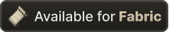
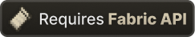

<div align="center">


# StarredHeltix

Современный клиентский мод для Fabric/Quilt загрузчиков модов с QOL-фичами для Heltix SkyBlock.

**Версия 1.0.0** · Minecraft 26.2 · Java 25




</div>

StarredHeltix делает игру на Heltix SkyBlock комфортнее, удобной и более привычной. Вдохновлён такими проектами, как [SkyHanni](https://github.com/SkyHanni/SkyHanni), [Firmament](https://modrinth.com/mod/firmament), [Skyblocker](https://modrinth.com/mod/skyblocker) и [Skysoft](https://modrinth.com/mod/skysoft).

## Основные фичи

### Кастомный табло

Заменяет ванильный сайдбар на полностью настраиваемый. Любую строку можно переставить, скрыть или перекрасить — банк, гемы, печенье, локация, сила и live-статистика клиента.

- Редактор перетаскиванием (`/sh hud editor`)
- Четыре стиля фона, включая свою картинку PNG с настройкой прозрачности и радиуса скругления
- Необязательные строки: FPS, пинг, CPS, BPS, сила аксессуаров

### Редактор HUD

Любой HUD-элемент можно двигать, масштабировать и включать/выключать прямо в игре. Раскладки сохраняются отдельно для каждого элемента и восстанавливаются при каждом запуске.

### Карта подземелий

Рисует карту из офф-хенда 1:1 — так, как её и положено видеть. Стили рамки, переключатель декораций, а также счётчики склепов и очков в реальном времени.

### Солверы данжей и головоломок

Автоматические решатели для рутины в данжах Heltix, чтобы глаза оставались на бою:

- Три незнакомца и сундук с ними
- Лучи крипера, крестики-нолики, вода на доске, лазеры 4-го этажа
- Эксперименты: Superpairs, Chronomatron, Ultrasequencer

### Чат и команды пати

Фильтры сообщений, свои бинды и команды пати (`!ping`, `!fps`, `!time`, `!coords`, `!rng`, `!dt`, `!promote`, `!kick`, `!invite`) прямо в чате пати, не выходя из него.

### Модули на JavaScript

Пиши свои фичи прямо в игре. Модули — обычные папки с JavaScript и CTJS-подобным API: свои HUD-элементы, батчи рендера, картинки, шрифты и звуки, бинды, команды, частицы, NPC, взаимодействие с миром и локальный HTTP-сервер для OAuth.

- Песочница (Rhino) со счётчиком инструкций: зависший скрипт не подвесит клиент
- Установка и обновление модулей с GitHub, а также библиотеки, на которые ссылаются другие
- Полный справочник API — в [docs/scripting-api.md](docs/scripting-api.md)

## Ещё фичи

<details>
<summary>Подсветки объектов</summary>

Подсветка мобов, мини-боссов и нод Энда, светящиеся грибы, маяки вредителей в саду и подсветка кликабельных слотов.

</details>

<details>
<summary>Оверлеи инвентаря и экипировки</summary>

Оверлей экипировки, оверлей питомца, лог истории инвентаря, превью хранилищ и полностью настраиваемые кнопки в инвентаре.

</details>

<details>
<summary>Уведомления-напоминалки</summary>

Правильные моменты для кусаний и событий — поклёвки, легендарные морские существа, авто-готовность в данже, очередь диалогов NPC, радар хотспотов.

</details>

<details>
<summary>Помощники по слоям, рыбалке и фармингу</summary>

HUD слоя, отображение скорости раннер-бутс, отслеживание кулдауна кеп дерева и полный свет.

</details>

<details>
<summary>Визуал и анимации</summary>

Редактор анимации замаха, оверлей блоков, блик на голове, подсветка слота в офф-хенде и своя рамка вокруг ванильного GUI.

</details>

<details>
<summary>Авто-спринт и плавный AOTE</summary>

Автоматический спринт без удержания клавиши и сглаженный AOTE для боя.

</details>

## Команды в игре

```
/sh                             главное меню настроек
/sh reset config                сбросить настройки
/sh hud editor                  редактор HUD (перетаскивание)
/sh buttons                     редактор кнопок в инвентаре
/sh filter, /sh binds           фильтры чата / свои бинды
/sh waypoints                   менеджер вейпоинтов
/sh rotation, /sh coords        поворот камеры / координаты
/sh update [install]            проверка / установка обновлений мода
/sh modules list|install|remove|on|off|reload|info|update|checkupdates
```

## Установка

StarredHeltix требует Minecraft **26.2** и [Java 25](https://adoptium.net/temurin/releases/?version=25).

<div align="center">
  
  
  
</div>

1. Установи [Fabric Loader](https://fabricmc.net/use/installer/) для Minecraft 26.2.
2. Установи [Fabric API](https://modrinth.com/mod/fabric-api) и [Fabric Language Kotlin](https://modrinth.com/mod/fabric-language-kotlin) — оба обязательны.
3. Скачай StarredHeltix из [GitHub Releases](https://github.com/Starlevka/StarredHeltix/releases/latest).
4. Положи моды в папку `mods` и запусти игру.

Меню настроек открывается командой `/sh` или `/starredheltix`. [Mod Menu](https://modrinth.com/mod/modmenu) поддерживается, но не обязателен.

## Поддержка и баги

Баг-репорты — через [GitHub Issues](https://github.com/Starlevka/StarredHeltix/issues): приложи версию Minecraft, версию мода и `latest.log`.

Официальные каналы сервера/поддержки (Telegram и Discord) — иконками в строке заголовка прямо в меню настроек, а также в категории **О моде**.

## Донат

Донаты полностью добровольные и помогают развивать мод. Веб-страницы с оплатой нет — номер карты можно скопировать в буфер одной кнопкой: `/sh` → **О моде** → **Скопировать номер**.

## Сборка (если надо для изменения мода)

Собрать мод:

```powershell
.\gradlew.bat build
```

```bash
./gradlew build
```

Готовый jar появляется в `build/libs`. Команда `./gradlew runClient` запускает дев-клиент — после любой миграции API проверь лог на `InvalidInjectionException` и `Invalid descriptor`.

Перед открытием pull request прочитай [CONTRIBUTING.md](CONTRIBUTING.md) — там описана сборка и архитектурные правила проекта.

## Лицензия

StarredHeltix распространяется под [GNU Lesser General Public License v3.0 only](LICENSE).

Стороннее ПО сохраняет собственные лицензии. Файлы, адаптированные из других проектов, сохраняют исходные уведомления об авторских правах.

StarredHeltix не является официальным сервисом Minecraft и не одобрен и не связан с Mojang, Microsoft или Heltix. :3
